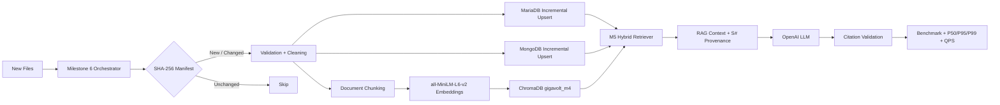

# Milestone 6 Architecture

## Design decisions

Milestone 6 is an orchestration and optimization layer over the existing semester work rather than a replacement.

- MariaDB reuses the Milestone 5 `gigavolt_m5` database.
- MongoDB reuses the Milestone 5 `gigavolt.telemetry` collection.
- ChromaDB reuses the Milestone 4 `gigavolt_m4` collection.
- SHA-256 hashes provide new/changed/unchanged detection.
- SQL and MongoDB use upsert-style loading.
- Changed documents delete only their previous source chunks before re-indexing.
- The M5 hybrid retriever and RAG provenance format are reused.
- Optimization is deliberately small: targeted database indexes plus a bounded process-local cache.
- Neo4j/graph ingestion is omitted because that requirement was dropped for this project.
